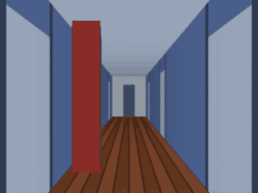
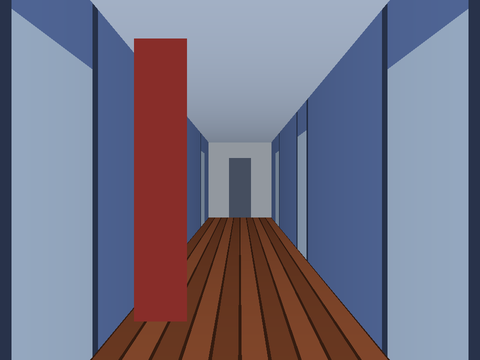
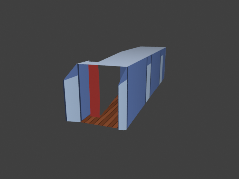
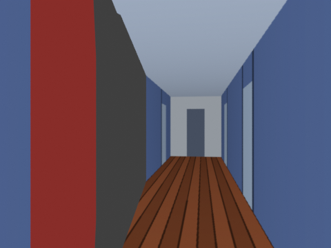
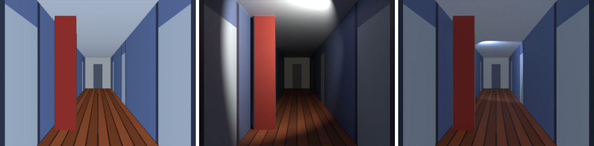

# Depth Scene (Marigold edition) — turn one 2D image into a 3D scene in Blender

> **Branch `marigold`.** This variant ships **only**
> [Marigold](https://github.com/prs-eth/Marigold) models: depth
> (`prs-eth/marigold-depth-v1-1`) builds the mesh, and the optional normals
> and intrinsic-image models (`marigold-normals-v1-1`,
> `marigold-iid-appearance-v1-1`, `marigold-iid-lighting-v1-1`) turn the image
> into a lit PBR material. It can also drive
> [**Marigold V2**](https://github.com/huawei-bayerlab/marigold-v2) (depth,
> normals, albedo) as an external GPU backend, see
> [Marigold V2 backend](#marigold-v2-backend-external-gpu). The `main`
> branch has the lighter models (Depth Anything V2, MoGe-2) and
> Illustrator's Depth instead.

A Blender add-on that estimates depth from a single image with Marigold, a
diffusion-based AI depth model, and rebuilds the picture as real 3D geometry. You can then move a camera
through it (2.5D / parallax shots) or use it as a relief. The workflow and
parameters follow the commercial
[TrueDepth](https://superhivemarket.com/products/truedepth) add-on. This is an
independent, open-source implementation and is not affiliated with TrueDepth.



*Dolly-in through a corridor rebuilt from one image (the synthetic test scene
in `tests/synthetic.py`). The dark band behind the red pillar is the area the
single photo never saw. See [Limitations](#limitations).*

| Source image | Rebuilt scene, seen from outside | New camera position |
|---|---|---|
|  |  |  |

---

## 1. Basic concept

The add-on works in three separate stages. Changing a setting in one stage
does not improve the others:

```
 image ──► [1] AI depth estimation ──► depth map (.exr)
   │                                      │
   │                 [2] geometry ◄───────┘   grid mesh, unprojected or displaced
   │                      │
   └─► [1b] material  ─► [3] shading            image re-projected from the camera;
       passes (optional)                        unlit, or lit with normal / albedo /
       normal, albedo, roughness,               roughness / metallic maps, lights
       metallic, shading, highlights            and cast shadows
```

**Stage 1: depth.** Marigold runs locally through ONNX Runtime (CPU or GPU,
no PyTorch in Blender) and produces a depth map. It is saved as a 32-bit EXR
so you can reuse or edit it.

**Stage 2: geometry.** There are two modes:

* **Perspective** (corridors, rooms, streets). Each vertex of an *N × M* grid
  is pushed along its camera ray to its estimated distance:

  ```
  x = (u − ½)·2·tan(FOV/2)·(W/max(W,H)) · z
  y = (½ − v)·2·tan(FOV/2)·(H/max(W,H)) · z
  position = (x, y, −z)        (Blender camera space, camera looks down −Z)
  ```

  Every vertex sits exactly on the ray of the pixel it came from, so the
  image lines up perfectly from the original viewpoint, and a corridor
  becomes a real corridor. Faces that span a depth jump (the "rubber sheet"
  between a door frame and the room behind it) are removed by **Remove
  Stretched Faces**.
* **Flat Relief.** A plane in the image's aspect ratio, displaced toward the
  camera by how near each pixel is. This gives a bas-relief look, suited to
  paintings and landscapes.

**Stage 3: shading.** The image is mapped with UVs that match the
projection. *Emission* shading renders exactly like the source photo.
*Principled* shading reacts to lights and casts shadows; with the optional
**material passes** (stage 1b, [below](#material-passes-lighting-and-shadows))
it uses an AI normal map, a de-lit albedo and roughness / metallic maps.

**Cameras (2.5D).** Each build creates two cameras under a rig empty:

* a locked **Projector** camera, at the viewpoint the image was taken from;
* a **Shot** camera that you animate.

Small Shot-camera moves give convincing parallax. Large moves reveal what the
photo never showed. Move the rig empty to place, rotate or scale the whole
scene.

### How Marigold works, and what that means for the settings

Marigold ([Ke et al., CVPR 2024](https://arxiv.org/abs/2312.02145)) is Stable
Diffusion 2 fine-tuned to *generate* a depth map for the input image. One
estimate runs in four stages:

1. The VAE encoder turns the image into a latent.
2. The U-Net denoises a random "depth latent" over a few **Denoising Steps**,
   conditioned on that image latent.
3. The VAE decoder turns the result back into a depth map.
4. Optionally, an **Ensemble** of runs with different noise is aligned and
   combined.

The add-on re-implements the diffusers pipeline around three ONNX graphs. The
DDIM scheduler is ported to NumPy and matches diffusers to 1e-6.

* **Output:** *affine-invariant depth*, 0 = near … 1 = far, with unknown
  scale and shift. The add-on maps it with **Linear** depth mapping:
  `z = near + (far − near) · depth`. Only the near/far *ratio* changes the
  shape. If walls bow, adjust **Far**.
* **Denoising Steps:** v1.1 is trained with zero-SNR, trailing timesteps for
  1–4 steps; 1 is usually enough. 0 uses the checkpoint default.
* **Processing Resolution:** default 768 px on the longer side (what SD2 was
  trained at). Lower is faster but less detailed.
* **Ensemble / Seed:** results vary slightly with the noise seed. An
  ensemble of N averages N runs and is N× slower.

| Mapping | Formula (t = 1 nearest … 0 farthest) | Use for |
|---|---|---|
| **Linear**  | z = t·near + (1−t)·far | Marigold v1.1 (default), "white = far" maps |
| **Logarithmic** | z = near^t · far^(1−t) | Marigold V2 log depth (default V2 checkpoint) |
| **Inverse** | 1/z = t/near + (1−t)/far | disparity maps from other tools |
| **Metric**  | z = depth × scale | metric EXRs from a renderer |

### Material passes: lighting and shadows

A mesh rebuilt from one image is coarse, and the image already contains the
painter's (or the sun's) lighting. Lighting it again in Blender works much
better with three more Marigold models, each toggled in **3. Material
Passes**:

| Toggle | Model | Maps | Used for |
|---|---|---|---|
| **Normal Map** | `marigold-normals-v1-1` | camera-space normals | lights shade detail the mesh is too coarse to show |
| **Albedo / Roughness / Metallic** | `marigold-iid-appearance-v1-1` | albedo (sRGB→linear), roughness, metallicity | de-lit base colour + PBR surface response |
| **Shading / Highlights** | `marigold-iid-lighting-v1-1` | albedo, diffuse shading, non-diffuse residual | keep painted soft shadows / glows on purpose |



*Left: unlit (Emission) = the source image. Middle: Principled shading, one
warm spot light; the pillar and walls cast real shadows. Right: a cool light
moved down the corridor, with Original Lighting 0.3. Synthetic test scene
with its ground-truth normal map; the real Marigold models could not be
downloaded in the development sandbox.*

How the maps are wired (Principled BSDF, rebuilt live on every change):

* **Normal map → Object space.** Marigold predicts normals in the camera's
  frame (x right, y up, z towards the viewer). The mesh is built in exactly
  that frame (it sits under the rig like the projector camera), so the map
  plugs into a Normal Map node in *Object* space with no conversion.
  Verified by rendering: shading with a ground-truth normal map differs from
  the true geometry by 0.002 (mean abs), while a flipped-X map differs by 0.50.
  **Strength** blends mesh normals (0) and map normals (1); >1 exaggerates.
  *Space: Tangent* and **Flip X / Y** are there for normal maps from other
  tools. **Bump** (image luminance) stacks on top.
* **Base colour** = image → albedo (**Albedo Mix**, **Albedo Gain**) →
  × **Baked Shading** (multiply). The albedo has the lighting removed, so
  painted shadows are not lit twice. Baked Shading puts back the soft
  shadows / ambient occlusion that the coarse mesh cannot cast.
* **Roughness** map remapped to **Min…Max**; **Metallic** map × **Strength**.
  Each falls back to a constant when its map is off.
* **Baked Highlights**: the IID-Lighting *residual* (specular highlights,
  lamps, glows) is added as emission × **Strength**.
* **Original Lighting** blends the whole material towards the unlit image
  (1 = looks exactly like the source, ignores lights).
* **Cast Shadows** toggles the object's shadow visibility. **Add Light**
  (Point / Area / Spot / Sun) drops a light in front of the projector, scaled
  to the scene's Near / Far.

IID-Lighting predicts its shading and residual only up to scale. The add-on
calibrates them with a 2-parameter, non-negative least-squares fit of
`image ≈ albedo × shading + residual` (the decomposition the model is trained
on). The fit error is shown in the status bar, and a large error means the
decomposition does not explain this image well. All maps stay at the
processing resolution; the mesh samples them through its image UVs, so they
need no resampling.

### Marigold V2 backend (external GPU)

[Marigold V2](https://github.com/huawei-bayerlab/marigold-v2) (Pavlovic et
al., SIGGRAPH Asia 2026) is a different model, not a v1.1 update. It turns
the Qwen-Image-Edit-2509 diffusion transformer (~20 B parameters, frozen,
quantised to 4 bit when loaded) into single-step predictors with small LoRA
adapters: depth (sharper edges, fur, hair), see-through depth, surface
normals and albedo.

**It cannot run inside Blender.** It needs:

* PyTorch + bitsandbytes on a **CUDA GPU**;
* about **17 GB of VRAM at 1024 px** and 29 GB at 2048 px;
* Linux;
* a one-time download of the Qwen backbone and checkpoints.

So the add-on runs *your* Marigold V2 install as a separate process,
through its official `scripts/infer.py`, and imports the result. Blender
stays responsive meanwhile: the status bar shows progress and **Esc**
cancels.

| | Marigold v1.1 (in Blender) | Marigold V2 (external) |
|---|---|---|
| Runs | ONNX Runtime inside Blender, CPU or GPU | your marigold-v2 Python environment, CUDA GPU |
| Hardware | any; ~9 GB RAM on CPU | NVIDIA GPU, 17+ GB VRAM (1024 px) |
| Depth output | affine-invariant depth → Linear | affine-invariant **log** depth → **Logarithmic** (other checkpoints: linear, disparity, see-through) |
| Material passes | normals, albedo/roughness/metallic, shading/highlights | normals, albedo (roughness/metallic/shading still from v1.1) |
| Licence | Open RAIL++-M (use restrictions) | **Apache-2.0** |
| Cost per run | seconds (GPU) to ~35 s (CPU) | backbone reload (minutes) + inference, per modality |

**Setup (one time, on the Linux + CUDA machine that runs Blender):**

```bash
git clone https://github.com/huawei-bayerlab/marigold-v2.git
cd marigold-v2
bash setup/setup_env.sh                              # conda env "marigold-v2"
conda activate marigold-v2
python scripts/download_assets.py --skip-datasets    # Qwen-Image-Edit-2509 + Marigold V2 checkpoints
python scripts/infer.py --image_dir assets/examples --output_dir output/examples   # test it once
```

Then open *Preferences → Add-ons → Depth Scene → Marigold V2* and set:

* **Python**: the environment's interpreter, e.g.
  `~/miniconda3/envs/marigold-v2/bin/python` (`which python` inside the
  activated env);
* **Repository**: the clone;
* **Assets Folder**: only if you set `DEPTH_ASSETS_DIR`.

The panel lists anything missing.

**Use:**

1. **2. Depth** → backend **Marigold V2 (external GPU)**.
2. Pick a **Depth Checkpoint**. *Log (default)* is the paper model;
   *Log, see-through* reconstructs what is behind glass / windows.
3. Set **Inference Resolution**: the longer side, in multiples of 16;
   0 = native size; 1024 needs ~17 GB VRAM.
4. Optional: tick **Normal Map (Marigold V2)** and **Albedo (Marigold V2)**
   in **3. Material Passes**. The v1.1 *Albedo / Roughness / Metallic* and
   *Shading / Highlights* passes can still be added; they run in Blender.
5. **Build 3D Scene**. It runs V2 for depth and the ticked passes, imports
   them, then builds the scene.

What the add-on does with V2's `.npy` outputs:

* **Depth** is clipped to the training range [−1, 1] and saved as EXR. The
  default checkpoints give log depth, which uses **Logarithmic** mapping.
* **Normals** use the same camera frame as v1.1, so they feed the same
  Object-space normal map.
* **Albedo:** `infer.py` writes linear albedo with a 1/2.2 gamma applied. The
  add-on undoes it (x^2.2) to get linear albedo again.

Every `infer.py` run reloads and re-quantises the 20 B backbone. So with
depth + normals + albedo, expect three model loads, each **minutes** long.
Results are reused while the image and V2 settings are unchanged. Logs and
inputs go to `<Save Location>/marigold_v2/<image>/`.

---

## 2. Licence: can I use Marigold commercially?

**Yes, with conditions.** Checked on 2026-10-12 (depth) and 2026-10-13
(normals, IID) against the [repo](https://github.com/prs-eth/Marigold), its
README ("The models are licensed under RAIL++-M") and `LICENSE-MODEL.txt`:

| Part | Licence | Commercial use |
|---|---|---|
| Marigold code (`prs-eth/Marigold`) | Apache-2.0 | ✅ |
| Weights `prs-eth/marigold-depth-v1-1` | **CreativeML Open RAIL++-M** | ✅ with use-based restrictions |
| Weights `marigold-normals-v1-1`, `marigold-iid-appearance-v1-1`, `marigold-iid-lighting-v1-1` | **CreativeML Open RAIL++-M** (repo README; a search snippet of the iid-lighting Hugging Face card says the same; the cards themselves could not be opened from the sandbox) | ✅ with use-based restrictions |
| Base model it was fine-tuned from (Stable Diffusion 2) | CreativeML Open RAIL++-M | ✅ with use-based restrictions |
| This add-on's code | GPL-3.0-or-later | ✅ |

What Open RAIL++-M asks of you:

* **No non-commercial clause.** It grants a royalty-free licence to use,
  reproduce and distribute, including as a hosted service. The licensor
  claims no rights in your outputs (the depth maps, meshes and renders).
* **Use-based restrictions** (§5, Attachment A) must be respected. If you
  *redistribute* the weights or the converted ONNX files (a "Derivative of
  the Model"), you must:
  * include the licence;
  * pass the restrictions on as an enforceable term;
  * mark modified files.
* ⚠️ Marigold's own `LICENSE-MODEL.txt` leaves Attachment A as a template
  placeholder ("[insert use restrictions]"). The concrete list therefore
  comes from Stable Diffusion 2's Open RAIL++-M, which Marigold derives from.
  It prohibits illegal use, harming minors, disinformation, harassment,
  discriminatory or medical-advice uses, and so on.
* The add-on never ships Marigold weights. You convert them yourself, so
  just *using* the add-on is unaffected. If you **sell** a product that
  bundles the converted ONNX files, the redistribution conditions above
  apply. Have a lawyer confirm for a commercial product.
* **Marigold V2** (Huawei Bayer Lab / EPFL / Bologna, Sept 2026) is
  licensed differently and more permissively: code and checkpoints are
  **Apache-2.0** (repo `LICENSE` and `NOTICE`). Its Qwen-Image-Edit-2509
  backbone is Apache-2.0 too (Hugging Face licence tag). Apache-2.0 has no
  use-based restrictions; keep the licence and `NOTICE` if you redistribute.
  The add-on ships nothing from V2; it only runs your own install.

---

## 3. Installation

Requires **Blender 4.2 LTS or newer**. Tested with Blender 4.2.23 LTS and
5.2.2 LTS.

1. **Get the add-on zip.** Either compress the `depth_scene` folder of this
   branch, or run `python tools/build_zip.py`.
2. **Install it.** In Blender, open *Edit → Preferences → Get Extensions*,
   then the **⌄** menu → **Install from Disk…** and pick the zip.
3. **Install the AI runtime.** Open *Preferences → Add-ons → Depth Scene*,
   choose the runtime and click **Install**:
   * **CPU** works everywhere;
   * **CUDA** needs an NVIDIA GPU with CUDA 12 + cuDNN 9;
   * **DirectML** works with any DirectX 12 GPU on Windows.

   Marigold is heavy, so a GPU is strongly recommended.
4. **Convert the models (one time, outside Blender).** Marigold is
   published as diffusers/PyTorch weights, so convert it with any Python
   3.10+:

   ```bash
   pip install torch diffusers transformers accelerate onnx onnxruntime onnxconverter-common
   python tools/export_marigold_onnx.py --task depth --check --fp16
   # optional material passes:
   python tools/export_marigold_onnx.py --task normals --check --fp16
   python tools/export_marigold_onnx.py --task iid-appearance --check --fp16
   python tools/export_marigold_onnx.py --task iid-lighting --check --fp16
   ```

   * Each run downloads the task's `prs-eth/marigold-*-v1-1` checkpoint from
     Hugging Face and writes `marigold_<task>_v1_1_fp32/`:
     `vae_encoder.onnx`, `unet.onnx` + `unet.onnx.data`, `vae_decoder.onnx`
     and `marigold.json`, about 3.6 GB.
   * `--fp16` also writes the `_fp16/` folder (about 2.0 GB) with a
     half-precision U-Net. It is smaller and was faster in our CPU test too.
   * `--check` compares the add-on's NumPy denoising loop against the
     official diffusers pipeline.

   Copy the folder(s) into the add-on's models folder (shown in the
   preferences; you can also set your own). Only the depth model is
   required; each pass needs only its own folder.

> You can use the add-on **without AI**: tick *Use Existing Depth Map* and
> load a depth map made elsewhere.

---

## 4. Quick start (corridor shot)

1. 3D Viewport → press **N** → **Depth Scene** tab.
2. **1. Image**: open your picture (JPG/PNG/WebP/EXR).
3. **2. Depth**: *Marigold Depth v1.1*, *Device: Auto*. Use *Precision:
   Float16* on a GPU and Float32 on CPU. Set *Processing Resolution 768*,
   *Denoising Steps 0* (the default, 1 step) and *Ensemble 1*.
   Optionally click **Generate Depth Map** to preview.
   With an NVIDIA GPU of 17+ GB, choose the **Marigold V2** backend instead
   ([setup](#marigold-v2-backend-external-gpu)).
4. **3. Material Passes** (optional): tick **Normal Map** and **Albedo /
   Roughness / Metallic** (and **Shading / Highlights** if you want to keep
   painted shadows).
5. **4. Build**: choose **Perspective** → **Build 3D Scene**. Build also
   runs the ticked passes and switches the material to *Principled*. For an
   existing scene, use **Generate for Active Object**.
6. **Lights & Shadows** → **Add Light** (Point / Area / Spot / Sun) and move
   it. Tune **Material** (live): Normal **Strength**, **Albedo Mix**,
   roughness **Min / Max**, **Baked Shading**, **Original Lighting**…
7. Tune in **Reconstruction** (live):
   * walls bowed → adjust **Far** (Linear mapping);
   * wrong perspective → set the **FOV** of the original lens or painting;
   * jagged edges around doors → lower **Stretch Threshold**;
   * noisy surfaces → **Smooth** 0.5–1 % or Ensemble 3–5.
8. **Camera / 2.5D** → **Add Camera Move** → *Dolly In* → render.

---

## 5. Parameters (and their TrueDepth counterparts)

| Depth Scene | TrueDepth | What it does |
|---|---|---|
| Backend v1.1 / V2 | — | In-Blender ONNX (v1.1) or your external Marigold V2 install |
| Model (Marigold v1.1) | Model Size | Depth network |
| V2: Depth Checkpoint, Inference Resolution, Seed | — | Log (default) / see-through / linear / disparity; longer side ×16 (0 = native); VAE sampling seed |
| Device Auto/GPU/CPU | Processing Device | Execution provider |
| Precision fp32/fp16 | Precision | fp16 halves the U-Net (2.0 vs 3.6 GB) and was faster even on CPU; max depth difference 0.008 |
| Processing Resolution | (implicit) | Longer side fed to Marigold (768 default, 0 = native) |
| Denoising Steps | — | Diffusion steps (0 = checkpoint default; 1–4 for v1.1) |
| Ensemble / Seed | — | Average N noisy runs / make results repeatable |
| Use Existing Depth Map | (import) | Skip AI and use your own depth map |
| Save Location | Save Location | Where depth EXRs go (`//` = next to the .blend) |
| Mode Perspective / Flat Relief | Perspective Mode / Flat Relief | Unprojection vs plane displacement |
| Resolution | Resolution / Grid Resolution | Vertices along the longer side (default 384) |
| Field of View | FOV | Camera FOV across the longer side, used for unprojection |
| Depth Mapping Linear/Inverse/Metric | Depth Mapping Linear/Inverse | See the table above |
| Near / Far | Near / Far Distance | Distance of the nearest / farthest pixel |
| Remove Stretched Faces + Threshold | Remove Stretched Faces | Deletes faces seen steeper than the threshold angle |
| Base Displacement | Base Displacement | Relief depth |
| Detail Displacement + Radius | Detail Displacement | Real geometry from image-luminance high-pass |
| Bump | Bump / Detail Bump | Shader-only detail (Principled shading) |
| Material Passes: Normal Map / Albedo-Roughness-Metallic / Shading-Highlights | — | Extra Marigold models → material maps (same resolution / steps / seed as depth) |
| Normal Map: Strength, Space, Flip X/Y | — | Mesh (0) ↔ AI normals (1); camera (Object) or tangent space |
| Albedo: Mix, Gain | — | Original image ↔ de-lit albedo; brightness |
| Baked Shading: Strength | — | Multiply painted diffuse shading back in |
| Roughness: Min/Max (or constant) · Metallic: Strength (or constant) | — | PBR surface response |
| Baked Highlights: Strength | — | Painted specular / glow (IID residual) as emission |
| Original Lighting | — | Blend towards the unlit image |
| Cast Shadows · Add Light | — | Shadow visibility; quick light rig |
| Smooth | Smooth | Blurs the depth map before meshing |
| Quantize Layers | — | Snaps depth to N flat layers (paper cut-out / diorama) |
| Use Alpha Channel | Include Alpha Channel | Deletes transparent areas (PNG cut-outs) |
| Projector / Shot camera | Projector / Shot Camera | 2.5D camera projection |

**Not implemented:** HDRI Studio / 360°, floor reflections, shadow catcher,
seamless textures, surface presets, 3D-printing tools, video/batch, tilt
correction.

---

## Limitations

* **Heavy.** ~950 M parameters (SD2 U-Net 866 M + VAE 84 M).
  * The model folder is 3.6 GB at fp32 and 2.0 GB at fp16.
  * Measured on a 4-core CPU with 1 step: about **32 s at 768 px** and
    9 s at 384 px, with roughly 9 GB peak RAM. Each extra step or ensemble
    member adds U-Net time.
  * Each **material pass** is another model run. At 768 px on 4 CPU cores,
    one VAE decode is ~19 s and dominates: normals ≈ depth (~35 s),
    IID-Appearance ~55 s (2 maps decoded), IID-Lighting ~75–100 s (3 maps),
    ~10 GB peak RAM. Use 384 px to try settings, or a GPU.
  * On a GPU it takes seconds.
  * Details are in [docs/RESEARCH.md](docs/RESEARCH.md).
* **Intrinsics were trained indoors.** IID-Appearance (InteriorVerse) and
  IID-Lighting (Hypersim) learned from synthetic indoor renders. Expect weaker
  albedo / roughness on paintings and outdoor scenes. The **Albedo Mix** and
  **Original Lighting** sliders let you back off.
* **No FOV estimate.** Marigold predicts depth only, so set the FOV
  yourself for perspective scenes.
* **Marigold V2 is external.** It needs an NVIDIA GPU with 17+ GB VRAM and
  a Linux Python environment. It reloads its 20 B backbone for every
  modality, so it takes minutes per run, and its RAM and disk needs are large
  (Qwen backbone download).
  The add-on only checks files; GPU and package problems show up as the
  run's error message, with the full log in
  `<Save Location>/marigold_v2/<image>/marigold_v2.log`. Tested against a
  stand-in `infer.py` with the same interface; the real model was not run
  (no GPU in the development sandbox).
* **Ensemble alignment** uses a least-squares approximation, because Blender
  has no SciPy and diffusers uses a SciPy optimiser. With Ensemble = 1
  (the default) results match diffusers.
* **One image cannot show what is behind things.** Keep camera moves small.

---

## Development

```
depth_scene/          the add-on (Blender extension, manifest + bl_info)
  core/               NumPy-only maths: resampling, depth mapping, unprojection,
                      stretched faces, DDIM scheduler port, material-pass maps (no bpy)
  ai/                 ONNX Runtime: Marigold pipeline (depth / normals / intrinsics)
                      + registry; marigold_v2.py: V2 command line + output conversion (no bpy)
  v2_job.py           runs a Marigold V2 install as a background process, imports results
  builder.py · properties.py · operators.py · ui.py · preferences.py
tests/                pytest: core maths, Marigold loop with fake ONNX graphs (all tasks),
                      DDIM + export parity vs diffusers (if installed), Blender integration
                      (incl. a normal-map convention render test); fake_marigold_v2.py
                      stands in for the V2 install
tools/export_marigold_onnx.py   convert a checkpoint (--task, --check, --fp16, --random-init [--tiny])
tools/build_zip.py              package the extension
```

```bash
pip install numpy onnx onnxruntime pytest bpy
python -m pytest tests/          # + torch diffusers for the parity test
```

## Licence

Add-on code: GPL-3.0-or-later (see `blender_manifest.toml`). Marigold v1.1
code: Apache-2.0; weights: CreativeML Open RAIL++-M (you convert them
yourself; nothing from them ships here). Marigold V2 code and checkpoints:
Apache-2.0 (you install them yourself). See [section 2](#2-licence-can-i-use-marigold-commercially).
